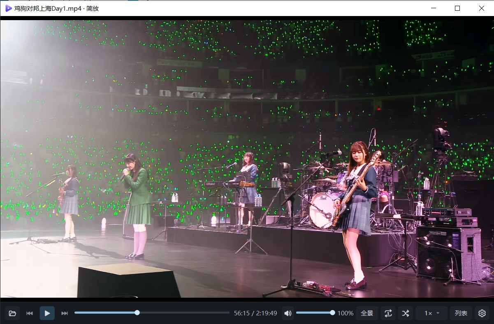

# 简放（EasyPlayer）

<div align="center">
  
</div>

一个极简 Windows 桌面播放器。Python 负责界面、快捷键和播放列表，PySide6 的 Qt Multimedia 使用 FFmpeg 后端处理音视频。

代码都是GPT 6.2（Sol+Astra）写的。我就是一个写提示词的。

**视频播放**



**全景播放**


## Windows x64 安装
可以在Release中安装。安装时可分别关联简放支持的全部音频格式或全部视频格式。勾选后会按扩展名设置常规文件关联。未勾选的类别仍可在「打开方式」中选择简放。Windows 明确保存的用户默认应用优先。同一账户卸载时，只恢复仍指向本次安装的关联。

安装包包含 Python、Qt 和 FFmpeg。如果新电脑提示缺少 `MSVCP140.dll` 或 `VCRUNTIME140.dll`，请安装 [Microsoft Visual C++ x64 运行库](https://learn.microsoft.com/zh-cn/cpp/windows/latest-supported-vc-redist)。

## 脚本方式启动

从工作区根目录安装依赖并启动，安装只需一次。

```powershell
.\.venv\Scripts\python.exe -m pip install -r .\requirements.txt
.\.venv\Scripts\python.exe .\player.py
```

也可双击 `start-player.cmd` 启动。

## 打包为安装包

重新打包，使用支持 `amd64-unicode` 目标的 NSIS。准备好编译器后，从工作区根目录运行以下命令。

```powershell
.\.venv\Scripts\python.exe -m pip install -r .\packaging\requirements-build.txt
powershell.exe -NoProfile -ExecutionPolicy RemoteSigned -File ".\packaging\build-installer.ps1"
```
此外包含`makensis.exe`的`mingw64`文件夹路径为`/.setup-tools/msys/mingw64`。（此打包工具未上传github。）


## 操作

| 操作 | 效果 |
| --- | --- |
| 单击画面或按 `空格` | 暂停或继续播放，即使焦点在其他按钮上 |
| 双击画面 | 切换全屏，退出后恢复原窗口状态 |
| 全屏时将鼠标移到画面底边 | 浮出进度条和播放控制，移开后自动收起 |
| `Esc` | 退出全屏 |
| `←` | 后退 5 秒 |
| 短按 `→` | 前进 5 秒 |
| 点击「列表」左边的倍速按钮 | 从 0.5× 到 4× 选择播放速度 |
| `Z` / `X` | 将所选速度分别降低或提高 0.5× |
| 长按 `→` 至少 350 毫秒 | 临时按设置中的倍速播放，默认 2×，松开恢复手动选择的速度 |
| `↑` / `↓`，或在画面及控制条上滚动鼠标滚轮 | 每档调节音量 5 个百分点 |
| 拖动控制条上的音量滑块 | 调节音量，旁边显示当前百分比 |
| 单击控制栏上的扬声器图标 | 静音或恢复原音量 |
| 单击文件夹图标或按 `Ctrl+O` | 打开文件，沿用上次选中文件时所在的目录 |
| 从资源管理器多选后拖入，或在 `Ctrl+O` 对话框多选 | 打开为新播放列表并立即播放 |
| 在资源管理器中右键选择「加入简放播放列表」 | 追加到最前面的简放窗口，未打开简放时开一个窗口。Windows 11 可在「显示更多选项」中找到 |
| 双击已关联的音频或视频文件 | 默认在已有窗口中播放新文件，开启「多窗口播放」后新开独立窗口 |
| 双击列表曲目 | 切换到选中的曲目 |
| 控制栏的单曲循环和随机图标 | 单曲循环时暂停随机播放，关闭循环后恢复此前的随机设置 |
| 右下角的齿轮 | 设置多窗口播放与长按 `→` 的倍速，倍速可选 1.5× 至 4× |
| 右下角齿轮 →「快捷键与鼠标操作」 | 查看按键和鼠标操作说明 |
| 左右拖动画面和播放列表之间的分界线 | 调整播放列表宽度 |

关闭单曲循环时，每首播完后自动进入下一首，播完列表后停止。播放设置、音量、静音状态、全景偏好和最近打开的文件夹保存在 `%APPDATA%\EasyPlayer\config.ini`。

## 360° 全景视频

打开等距柱状投影（equirectangular）的单目 360° 视频后，点击控制条上的「全景」。简放会记住上次是否开启全景以及所用的缩放程度。

在全景模式中，按住鼠标左键拖动画面，或按 `W` / `A` / `S` / `D` 向上、左、下、右转向。`Q` 放大，`E` 缩小。视角越宽，播放器越会压缩画面边缘，减轻拉伸。单击暂停、双击全屏和滚轮调音量可照常使用。

## 网页版全景播放器
网页版全景播放器是一个HTML播放器，主要是https://haujetzhao.github.io/Panorama-Viewer-HTML/ 写的。我按照本人习惯优化了少量操作和镜头。项目太小就放在一起了。这个网页播放器和这个Windows桌面播放器无关。
